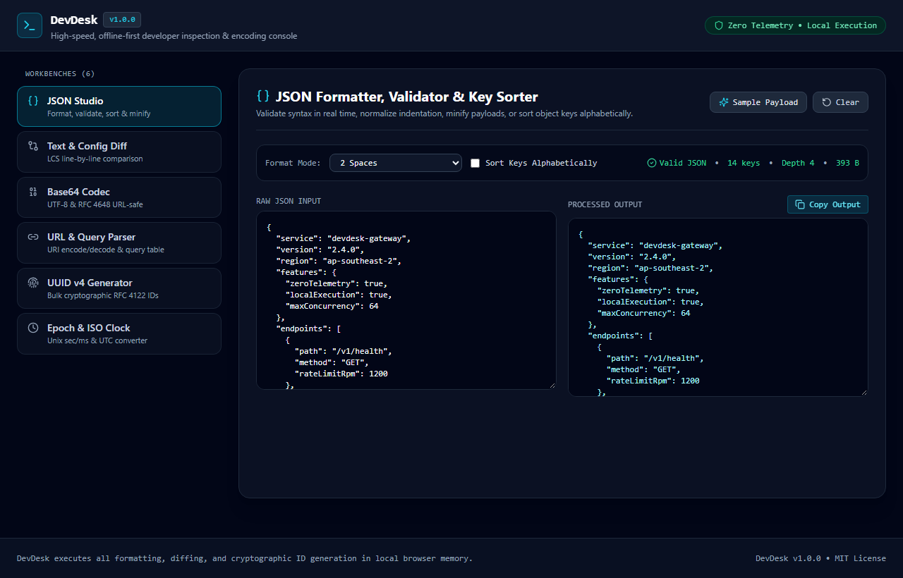
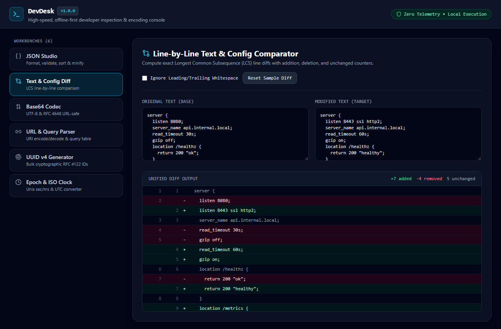
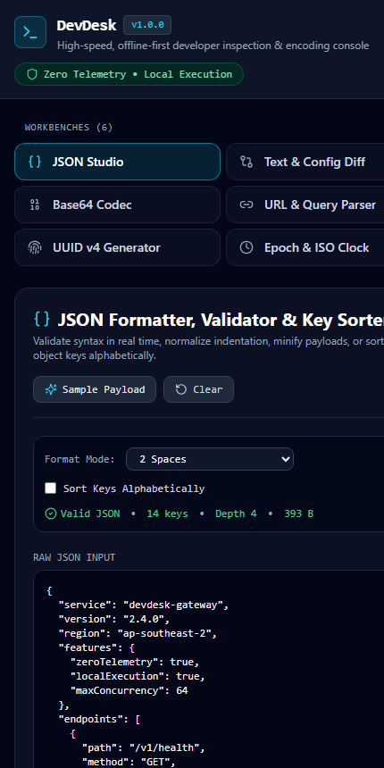

# DevDesk — Offline Developer Utilities & Inspection Console

[](https://opensource.org/licenses/MIT)
[](https://www.typescriptlang.org/)
[](https://react.dev/)
[](https://github.com/iamnarace/devdesk/actions/workflows/ci.yml)

**DevDesk** is a fast, zero-telemetry developer utility workbench for formatting and sorting JSON payloads, computing line-by-line configuration diffs, encoding/decoding UTF-8 Base64 and URLs, generating bulk RFC 4122 v4 UUIDs, and converting Unix epoch timestamps—100% locally in your browser.

---

## Why DevDesk?

Developers frequently need to format an API response, inspect a URL query string, decode a Base64 header, or compare two configuration blocks. Pasting production logs or internal configuration snippets into ad-supported web tools risks leaking sensitive data.

**DevDesk** provides six essential developer utilities in a single high-contrast terminal-inspired interface that runs entirely on your device with zero external network requests.

---

## Key Features

- **JSON Studio:** Real-time JSON syntax validation, 2-space / 4-space / tab indentation, single-line minification, recursive alphabetical key sorting, and payload metrics (total keys, nesting depth, UTF-8 byte size).
- **Text & Config Diff:** Line-by-line Longest Common Subsequence (LCS) comparator with line numbers, added/removed/unchanged counters, and optional whitespace normalization.
- **UTF-8 Base64 Codec:** Encode and decode multi-byte UTF-8 text using standard Base64 or RFC 4648 URL-safe Base64 (`-` and `_` without padding).
- **URL & Query Parser:** Encode or decode URI components and automatically parse URL query parameters into a clean key-value inspection table.
- **Bulk UUID v4 Generator:** Generate 1 to 50 cryptographically random RFC 4122 v4 UUIDs at once via the Web Crypto API, with toggles for hyphens, uppercase, and braces.
- **Epoch & ISO Clock:** Convert Unix timestamps (automatically detecting seconds vs. milliseconds) and ISO-8601 strings into UTC, day-of-year, leap-year status, and relative time descriptions.

---

## Screenshots

### Desktop — JSON Studio & Structural Inspector


### Feature View — LCS Line-by-Line Text & Config Comparator


### Mobile Responsive View
<p align="left">
  
</p>

---

## Technology Stack

- **Framework:** React 18 + TypeScript 5
- **Styling:** Tailwind CSS (Carbon Slate & Cyan terminal dark theme)
- **Icons:** Lucide React
- **Build & Test:** Vite 6, Vitest 4, React Testing Library, ESLint

---

## Requirements & Installation

- **Node.js:** v20+ LTS recommended (v18.18+ supported for build/runtime)
- **npm:** v9+

```bash
# Clone the repository
git clone https://github.com/iamnarace/devdesk.git
cd devdesk

# Install dependencies
npm install
```

---

## Local Development, Build & Testing

```bash
# Start local development server
npm run dev

# Run ESLint check
npm run lint

# Run Vitest unit & integration test suite
npm test

# Build production bundle
npm run build
```

---

## Usage Guide

1. Select any of the 6 workbenches from the left sidebar (**JSON Studio**, **Text & Config Diff**, **Base64 Codec**, **URL & Query Parser**, **UUID v4 Generator**, or **Epoch & ISO Clock**).
2. Each tool preloads realistic sample data so you can inspect its behavior immediately or click **Clear** to paste your own input.
3. Click any **Copy** button to copy formatted outputs or batch-generated UUIDs directly to your clipboard.

---

## Project Structure

```text
devdesk/
├── .github/
│   ├── ISSUE_TEMPLATE/
│   ├── workflows/ci.yml
│   └── pull_request_template.md
├── docs/
│   └── screenshots/
├── src/
│   ├── test/
│   │   ├── devTools.test.tsx
│   │   └── setup.ts
│   ├── utils/
│   │   └── devTools.ts
│   ├── App.tsx
│   ├── index.css
│   └── main.tsx
├── CHANGELOG.md
├── CONTRIBUTING.md
├── LICENSE
├── SECURITY.md
├── package.json
└── vite.config.ts
```

---

## Security & Privacy Considerations

- **Offline-Ready Execution:** All inputs remain in local browser memory. Nothing is logged, stored on a remote server, or transmitted over the network.
- **Web Crypto UUIDs:** UUID v4 generation uses `crypto.randomUUID()` / `crypto.getRandomValues()` rather than predictable `Math.random()` values when available.

---

## Known Limitations

- **LCS Diff Complexity Guard:** The dynamic programming line-diff engine enforces a synchronous input limit of 1,500 lines or 150 KB per pane (`MAX_DIFF_LINES = 1500`, `MAX_DIFF_CHARS = 150_000`), automatically truncating oversized inputs and surfacing a warning banner to prevent main-thread UI freezes.
- **Standard JSON Only:** JSON Studio validates strict RFC 8259 JSON and does not parse JSON5 comments or trailing commas.

---

## Roadmap

- [ ] JSONPath query filter expression bar
- [ ] JWT header/payload offline inspector tab
- [ ] SHA-256 / SHA-512 Web Crypto digest calculator
- [ ] Side-by-side split view option for Text Diff

---

## Contributing

Please see [CONTRIBUTING.md](./CONTRIBUTING.md) for development setup and pull request guidelines.

---

## Acknowledgements

Developed with assistance from Google Antigravity.

---

## License

Licensed under the [MIT License](./LICENSE). Copyright (c) 2026 Naresh Adhikari.
